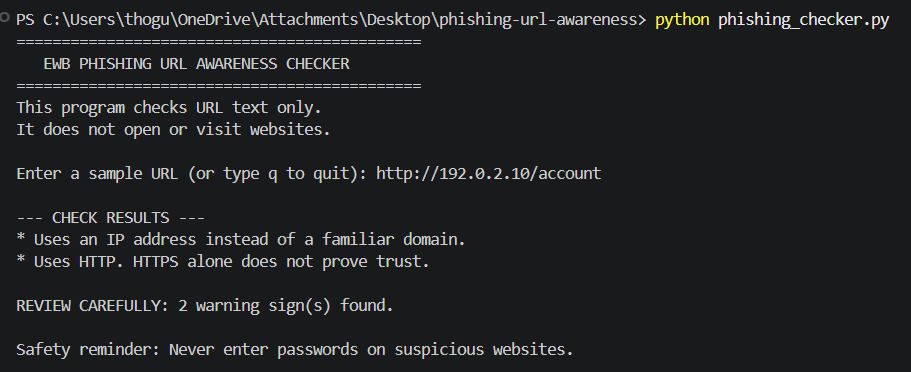
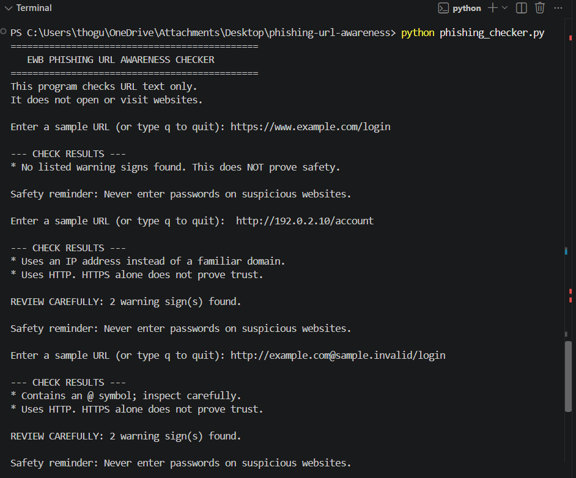
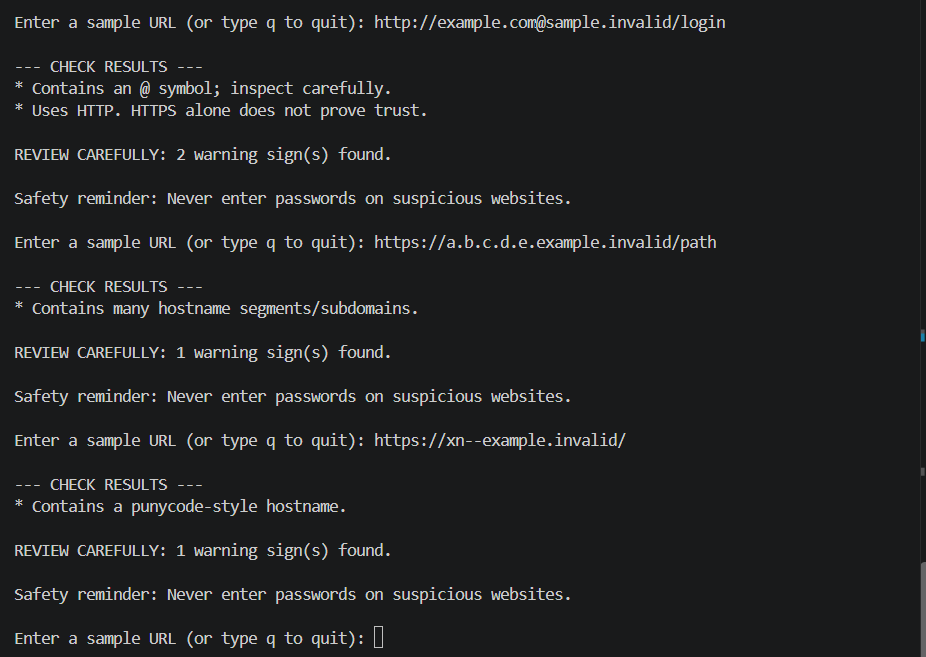

# EWB Phishing URL Awareness Checker

**Author:** Rohitha  
**Language:** Python 3.10+  
**Project Type:** Cybersecurity Mini Project  
**Operating System:** Windows  

## 1. Overview

Phishing is a cyberattack in which attackers attempt to trick users into revealing sensitive information through deceptive messages or links. The EWB Phishing URL Awareness Checker is a Python command-line application that examines URL text for selected warning signs associated with phishing.

The program performs its checks locally without opening websites, making internet requests, or scanning website content. It is an educational tool designed to improve awareness of potentially suspicious URLs.

## 2. Features

The program checks for the following six warning signs:

- **@ Symbol:** Identifies URLs containing an `@` symbol.
- **Unusually Long URL:** Flags URLs longer than 100 characters.
- **IP Address Hostname:** Detects IPv4-address hostnames instead of familiar domain names.
- **Multiple Hostname Segments:** Flags hostnames containing five or more dot-separated segments.
- **Punycode Marker:** Identifies the `xn--` marker in a hostname.
- **HTTP Scheme:** Warns when a URL uses HTTP instead of HTTPS.

The program displays the findings in the terminal and reminds users to be careful with unfamiliar links.

## 3. Requirements

- Python 3.10 or later.
- Visual Studio Code or another Python-compatible editor.
- No additional Python packages are required.

The program uses Python's standard library modules, including `re` and `urllib.parse`.

## 4. How to Run

### Step 1: Open the Project

Open the project folder in Visual Studio Code.

### Step 2: Open the Terminal

Select **Terminal → New Terminal**.

### Step 3: Run the Program

On Windows, enter:

```powershell
python phishing_checker.py
```

If that command does not work, try:

```powershell
py phishing_checker.py
```

### Step 4: Enter a URL

Enter a sample URL when prompted. The program displays the identified warning signs.

### Step 5: Exit the Program

Type `q`, `quit`, or `exit` to stop the program.

## 5. Example Output

**Input:**

```text
http://192.0.2.10/account
```

**Expected output:**

```text
Result:
- Uses an IP address instead of a familiar domain.
- Uses HTTP. HTTPS alone does not prove trust.

REVIEW CAREFULLY: 2 warning sign(s) found.
```

The exact formatting may vary slightly depending on the program version.

## 6. Testing

The program was tested using five sample URLs to check whether it identifies the selected warning signs.

| # | Input | Expected Result | Status |
|---|---|---|---|
| 1 | `https://www.example.com/login` | No listed warning signs | PASS |
| 2 | `http://192.0.2.10/account` | IP address and HTTP warnings | PASS |
| 3 | `http://example.com@sample.invalid/login` | @ symbol and HTTP warnings | PASS |
| 4 | `https://a.b.c.d.e.example.invalid/path` | Many hostname segments warning | PASS |
| 5 | `https://xn--example.invalid/` | Punycode-style hostname warning | PASS |

The complete test results, including actual observations, are documented in `tests/test_samples.md`.

The PASS statuses should be retained only if the corresponding tests were run and their output matched the expected results.

## 7. Improvements Implemented

### Improvement 1: Loop with Quit Command (Option A)

A `while True` loop allows users to check multiple URLs without restarting the program each time. Users can type `q`, `quit`, or `exit` to end the program.

**Benefit:** Makes the program easier to use when testing multiple URLs.

**Testing:** Entered multiple sample URLs in one session and used the quit command to exit.

### Improvement 2: Review Carefully Summary (Option B)

The program displays a `REVIEW CAREFULLY` message when it identifies warning signs. It also displays the number of warning signs found.

**Benefit:** Helps users notice when a URL requires further attention.

**Testing:** Used `http://192.0.2.10/account` and checked that the program reported two warning signs.

### Improvement 3: Malformed Input Handling (Option C)

A `try/except` block handles certain URL-parsing errors. If parsing raises a `ValueError`, the program displays a clear error message instead of stopping unexpectedly.

**Benefit:** Improves the program's handling of malformed input.

**Testing:** Tested malformed input that triggers the parsing error handler and verified that the program displays the error message.

## 8. Screenshots

Screenshots of the program execution and test results are included in the `screenshots` folder.

### Sample Program Run



### Test Results — Part 1



### Test Results — Part 2



These images document the program execution and the test results.

## 9. Limitations

- The program examines URL text only.
- It does not open or visit websites.
- It does not make internet requests or scan for malware.
- It does not inspect website content or verify a website's identity.
- It checks only selected warning signs and may miss phishing URLs.
- A warning does not prove that a URL is malicious.
- No warning signs found does **not** mean a URL is safe.
- HTTPS alone does not guarantee that a website is trustworthy.

## 10. Ethical Use

This project is intended for educational and cybersecurity-awareness purposes.

- Use sample URL strings for testing.
- Do not enter passwords or other sensitive information on suspicious websites.
- Do not use this project to deceive users or test websites without permission.
- Treat the results as basic indicators, not a complete security assessment.

## 11. Conclusion

The EWB Phishing URL Awareness Checker demonstrates how Python can be used to identify selected warning signs in URL text. The project also applies loops, conditional statements, exception handling, and formatted terminal output.

The implemented improvements make the program more convenient to use and its results easier to understand. Although it provides a basic introduction to phishing awareness, it cannot guarantee whether a URL is safe or malicious.

## 12. Author

**Name:** Rohitha  
**Project:** EWB Phishing URL Awareness Checker  
**Course:** Cybersecurity Mini Project